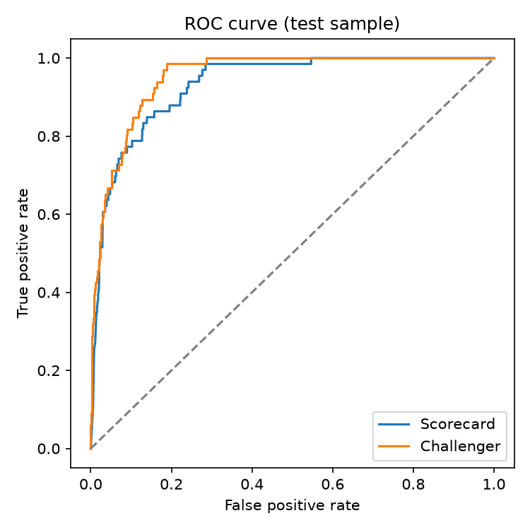
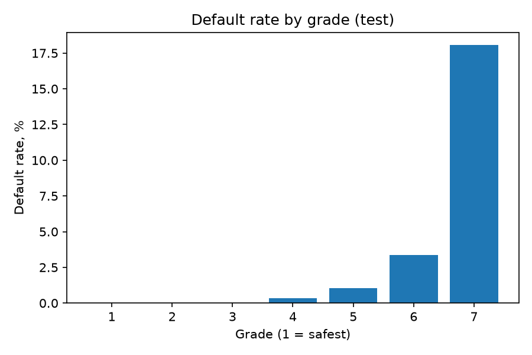

# Credit Risk PD Model

A probability-of-default (PD) model for companies, built and validated the way a bank's credit-risk and model-validation teams work: a transparent scorecard as the main model, a machine-learning challenger, and an automatically generated validation report.

## What it does

**1. Scorecard (main model)**
- Each financial ratio is split into five ranges (quantiles of the development sample; missing values get their own range).
- Each range is replaced by its **weight of evidence**, WoE = ln(% of non-defaulters / % of defaulters). Positive means safer than average, negative means riskier.
- Ratios are kept by **information value** (IV ≥ 0.1, up to 10 ratios), skipping any ratio correlated above 0.7 with a stronger one.
- A logistic regression on the WoE values gives the PD.
- The model is turned into **points**: 600 points at odds of 50:1, and 20 more points each time the odds double. `points_table.csv` lists the points for every range, so anyone can score a firm by hand.

**2. Challenger**
- Gradient boosting on the raw ratios, with SHAP to show what drives it. It handles missing values and non-linear effects on its own; the question is whether it ranks firms enough better to justify being harder to explain.

**3. Validation report** (`outputs/validation_report.md`, on the test sample)

| Check | Measure | What it answers |
|---|---|---|
| Discrimination | AUC, Gini, KS | Does the model rank defaulters above non-defaulters? |
| Calibration | Predicted vs observed PD by decile, Brier score, Hosmer-Lemeshow test | Are the PDs right in level, not just in order? |
| Stability | Population stability index (PSI) of the score | Does the score distribution shift between samples? |
| Rating grades | Default rate in grades 1 (safest) to 7 | Do default rates rise steadily from grade to grade? |
| Comparison | Scorecard vs challenger Gini | Is the more complex model worth it? |

The report ends with plain-language findings and the model's limitations.

**No leakage.** Ranges, weights of evidence, variable selection, the model and the grade boundaries are all set on the development sample (70%); the test sample (30%) is only scored.

## Quick start

```bash
pip install -r requirements.txt
python scripts/download_data.py      # Taiwanese company bankruptcies, UCI (6,819 firms, 95 ratios)
python main.py                       # report and charts in outputs/
```

Your own data works too: a CSV with numeric ratios and a `default` column (1 = defaulted, 0 = not), passed with `--data`.

## Results

UCI Taiwanese bankruptcy data: 6,819 firms, 3.2% defaulted, split 70/30 with the same default rate in both parts. All figures are on the 2,046-firm test sample.

| | Scorecard | Challenger (gradient boosting) |
|---|---|---|
| AUC | 0.932 | 0.953 |
| Gini | 0.864 | 0.905 |
| KS | 0.709 | 0.797 |
| Brier score | 0.0241 | 0.0225 |

- **Variables:** nine ratios, led by persistent EPS, debt to net worth, borrowing dependency and the quick ratio. `net_value_per_share_c` was dropped because its coefficient came out with the wrong sign.
- **Calibration:** Hosmer-Lemeshow statistic 8.76 (p = 0.36), so predicted and observed default rates agree across ten risk groups.
- **Stability:** population stability index of 0.009 between the development and test samples.
- **Rating grades:** no defaults in grades 1 to 3, then 0.35%, 1.0%, 3.4% and 18.1% in grades 4 to 7.
- **Challenger:** ranks firms better (Gini 0.90 against 0.86), but the scorecard can be added up by hand from the points table, which is what a credit committee and a validator can check.





## Tests

```bash
pytest
```

The tests check the sign and size of the weight of evidence, that ranges are learned from development data only, that the scorecard picks the true drivers with the expected signs, that the points table adds up to the score, that a higher score always means a lower PD, that PSI and Hosmer-Lemeshow behave as expected, and that a full run writes the report.

## Project structure

```
├── main.py                  # runs everything and writes the report
├── scripts/download_data.py
├── src/
│   ├── data.py              # load, clean names, stratified split
│   ├── scorecard.py         # binning, WoE/IV, selection, logistic regression, points
│   ├── challenger.py        # gradient boosting and SHAP
│   ├── validation.py        # Gini, KS, calibration, Hosmer-Lemeshow, PSI, grades, findings
│   └── report.py            # charts and the Markdown report
└── tests/test_pd_model.py
```

## Limitations

- The public data has no dates, so the test sample is a random hold-out rather than a later period.
- Default means a bankruptcy filing, not the 90-days-past-due definition used under Basel rules.
- PDs reflect this sample's default rate and would be recalibrated to a portfolio's long-run rate before use.
- Some bins are not monotonic in weight of evidence (borrowing dependency, quick ratio, tax rate), and two variables (tax rate, operating profit per person) move the score by four points at most. A production scorecard would merge those bins or drop those variables.
- Grades 1 to 3 have no defaults in the test sample, so their PDs rest on very few observations and would need a floor.

## Data

Liang, D., Lu, C.-C., Tsai, C.-F. and Shih, G.-A. (2016). Financial ratios and corporate governance indicators in bankruptcy prediction. *European Journal of Operational Research*, 252(2). UCI Machine Learning Repository, id 572.

## License

MIT
